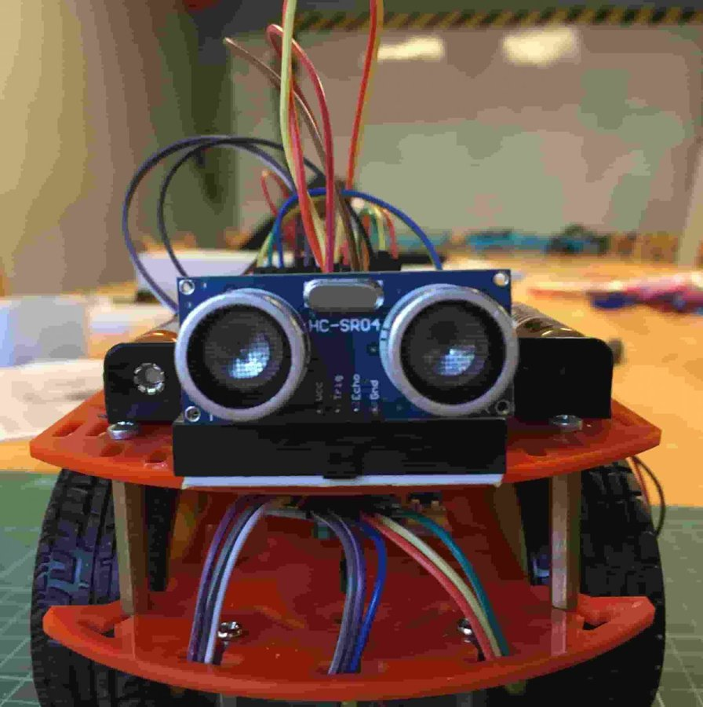

# Arduino projects

Small projects I built while learning Arduino. Both run on an Arduino Uno.

## Robot arm (4 servos)

`robot-arm/robot-arm.ino`

A 4-axis robot arm on a 3D-printed/acrylic kit body. Each joint is an SG90/MG90S servo.

I built a few versions depending on the parts I had: two joysticks,
one joystick with four buttons, and one joystick with two potentiometers.
The code here is the last one:

- Joystick X and Y move two of the joints.
- Two potentiometers move the other two.
- Each analog reading (0-1023) is mapped to a servo angle (0-180°).

## Obstacle-avoiding car

`obstacle-avoiding-car/obstacle-avoiding-car.ino`

A two-wheel car with a caster ball at the back.

- HC-SR04 ultrasonic sensor measures the distance in front.
- If something is closer than 15 cm, the car backs up and turns right.
- Two DC motors, driven by an L298N motor driver.

The code is based on a common tutorial example, with small changes.
I assembled and wired the car myself and tested it.
